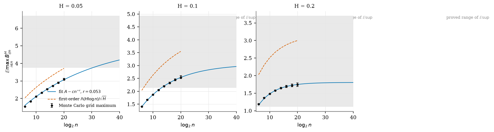
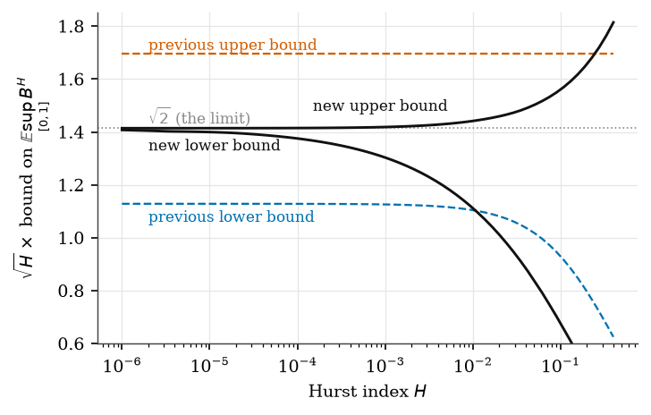
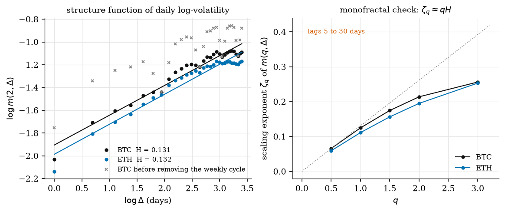
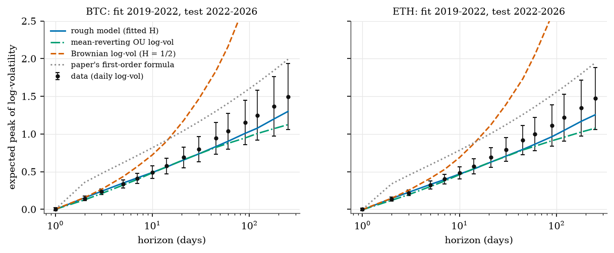
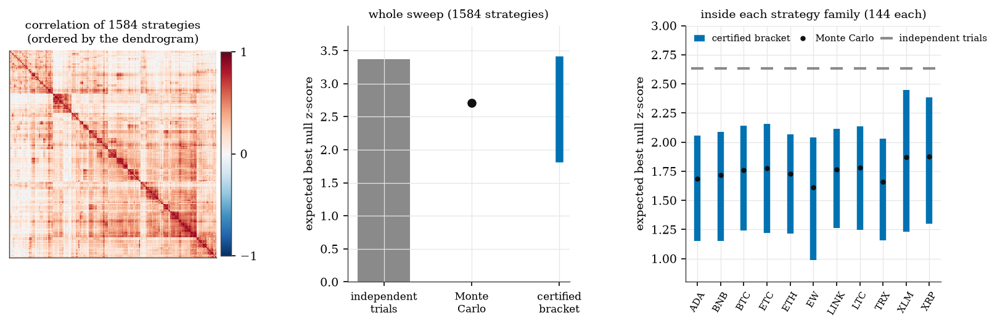
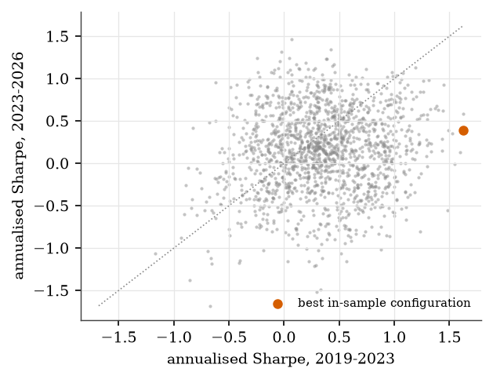

# roughmax

**Extremes of rough Gaussian processes, applied to quantitative research.**

`roughmax` turns the results of the paper *The maximum of fractional Brownian motion as H → 0: sharp asymptotics, free energy, and a continuous random energy model* ([docs/paper.pdf](docs/paper.pdf)) into tested code. It then uses that code on three problems a quant researcher meets in practice:

1. **Monte Carlo of rough paths.** How badly does a simulated path miss its own peak, and how do you correct for it?
2. **Peak-volatility risk.** Volatility is rough (H ≈ 0.1). How high will it climb over the next week, month or year?
3. **Selection bias in correlated backtests.** How large should the best Sharpe ratio of a strategy sweep be under the null, when the strategies are correlated?

Everything below is produced by the scripts in [`experiments/`](experiments) from public Binance data, and every number is read from [`reports/`](reports).

## Key findings

| | Finding |
|---|---|
| Simulation | Even with 2²⁰ ≈ 10⁶ grid points, the simulated maximum of fBm with H = 0.05 stays **17% below the proved lower bound** on the true expected supremum. The discretisation bias decays like n^(−r) with fitted r = 0.053 ± 0.017, 0.118 ± 0.024 and 0.249 ± 0.060 for H = 0.05, 0.1 and 0.2, which matches the paper's rate n^(−H). Extrapolating at the usual Brownian rate n^(−1/2) leaves the estimate below the proved bound; extrapolating at rate H lands inside it. |
| Roughness | Daily log realised volatility of BTC and ETH (2019 to 2026, 5-minute bars) has **H = 0.131 (90% CI 0.112 to 0.153) and H = 0.132 (0.115 to 0.150)** once the weekly volatility cycle is removed. Without that step the estimate is biased down to 0.100 and 0.109. |
| Peak-volatility risk | A three-parameter rough model, fitted on 2019 to 2022 using only lags of at most 30 days, predicts the 2022 to 2026 expected peak of log-volatility over horizons from 1 to 250 days with **8.1% (BTC) and 9.7% (ETH) mean relative error**. A mean-reverting OU log-volatility fitted to the same statistic gets 11.4% and 13.8%; Brownian log-volatility gets about 100%. |
| Tails | Both Gaussian models under-cover the tails of volatility peaks, a sign of heavy tails. At the 1% level over 90 days the rough model is breached on 2.3% (BTC) and 1.7% (ETH) of test windows, OU on 6.2% and 6.0%. The rigorous bound from the paper is never breached more often than its nominal level. |
| Selection bias | In a sweep of 1,584 trend-following strategies on 10 crypto assets, the null expected best z-score is 2.71 (Monte Carlo), not the 3.37 that the usual independent-trials assumption implies: the sweep behaves like **177 independent trials, not 1,584**. With the correct bar the deflated Sharpe confidence of the best strategy is 0.67 instead of 0.41. Within each strategy family the paper's tree comparison gives a **Monte-Carlo-free certified upper bound** (2.03 to 2.45, against 2.64 for independent trials). |

## 1. Rough paths hide their peaks from simulation

For fractional Brownian motion B^H on [0, 1] the paper proves

$$\sqrt{H}\ \mathbb{E}\sup_{[0,1]} B^H \longrightarrow \sqrt{2}\qquad (H\to 0),$$

with explicit two-sided bounds for every H, and it shows that the maximum over n equally spaced points captures only the fraction Λ(H log n)/√2 of the supremum, where Λ(κ) = √κ for κ ≤ 1/2 and Λ(κ) = √2 − e^{1/2−κ}/√2 beyond. The discretisation bias is of order n^(−H), not the n^(−1/2) familiar from Brownian motion.



*Exact (circulant-embedding) simulation of max over n grid points, n = 2⁶ … 2²⁰. Grey band: the range in which the paper proves the true expected supremum lies. Blue: power-law fit A − c n^(−r) on n ≥ 2¹⁰; the fitted rates match H.*

| H | grid max at n = 2²⁰ | proved range of E sup | fitted rate r | extrapolation at rate H | at rate 1/2 |
|---|---|---|---|---|---|
| 0.05 | 3.09 | [3.75, 6.72] | 0.053 ± 0.017 | 5.60 | 3.22 |
| 0.10 | 2.55 | [2.13, 4.93] | 0.118 ± 0.024 | 3.24 | 2.62 |
| 0.20 | 1.74 | [1.11, 3.71] | 0.249 ± 0.060 | 1.82 | 1.76 |

At H = 0.05 the fitted curve needs about 2³⁰ grid points just to reach the proved lower bound. To first order, capturing 90% of the supremum of an H = 0.1 path on a uniform grid takes about 1.5 × 10⁹ points ([`01_theory.json`](reports/01_theory.json)).



## 2. Crypto volatility is rough

Daily realised variance is computed from 5-minute bars (days with fewer than 90% of bars are dropped), and x_t = log √RV_t. The structure function m(2, Δ) = E|x_{t+Δ} − x_t|² is fitted on lags of 1 to 30 days by m = 2s² + ν²Δ^{2H}, which separates roughness from the estimation noise of RV.



The grey crosses show the raw series: dips at 7, 14, 21 and 28 days come from the weekly cycle of crypto volatility, and they bias H downwards. Removing day-of-week means fixes this. The point at lag 1 lies slightly below the line, as expected because daily RV averages spot volatility within the day. The exponents ζ_q bend below qH for q ≥ 2, which points to heavier-than-Gaussian increments. Splitting the sample gives H = 0.135 and 0.121 for BTC and 0.144 and 0.114 for ETH.

## 3. Peak-volatility risk

How far can log-volatility rise over the next n days? The quantity is the peak excursion max_{1≤i≤n} (x_{t+i} − x_t). Under the rough model its mean is predicted by exact simulation and, to first order, by the paper's formula ν n^H Λ(H log n)/√H.



*Parameters fitted on 2019-01 to 2022-11, peaks measured on 2022-11 to 2026-09.*

| out of sample | rough (fitted H) | OU (H = 1/2, mean-reverting) | Brownian (H = 1/2) |
|---|---|---|---|
| BTC: mean abs. error (log-vol), relative error (n ≥ 5) | **0.072, 8.1%** | 0.106, 11.4% | 0.884, 101% |
| ETH | **0.081, 9.7%** | 0.119, 13.8% | 0.810, 94% |

Tail calibration on the test period (share of windows whose peak exceeds the predicted 99% quantile):

| horizon | rough | OU | rigorous bound |
|---|---|---|---|
| BTC, 7 days | 3.1% | 2.6% | 0.8% |
| BTC, 90 days | 2.3% | 6.2% | 0.0% |
| ETH, 90 days | 1.7% | 6.0% | 0.0% |

The rigorous bound (`peakrisk.grid_peak_bound`) combines the paper's bound for any n points, E max ≤ ν n^H μ_n/√2, with the Borell–TIS inequality. It is valid at every level but conservative. The fitted Gaussian models are sharper but under-cover the tails. A practical risk number sits between the two, for example the rough-model quantile with a heavy-tail adjustment.

What daily data cannot show: if the rough scaling extends below one day, the paper implies that a daily grid captures only about 47% of the supremum of spot log-volatility over 30 days. In volatility units this means intraday spot peaks about 3.3 to 3.5 times higher than the daily-sampled peak. This is a model statement (first-order asymptotics) that daily data cannot test.

## 4. Selection bias in correlated backtests

The Deflated Sharpe Ratio of Bailey and López de Prado compares the best Sharpe ratio of N trials with E max Z, where Z ~ N(0, C) are the null z-scores. The common shortcut treats the trials as independent. `roughmax.selection` uses the paper's comparison method instead:

- any dendrogram of the strategies, with merge heights refitted as the **largest** distance across each split, defines a tree process that dominates Z (Sudakov–Fernique), so its expected maximum is an **upper bound**;
- with the **smallest** distance across each split, on the full set or on a well-separated subset (the paper's Cantor idea), it gives a **lower bound**;
- the expected maximum of a tree process is computed **exactly** by a CDF recursion over the dendrogram, with no simulation.



| 1,584 strategies, 2019-10 to 2026-09 | E max z (null) | effective independent trials |
|---|---|---|
| independent trials (exact / Bailey–López de Prado formula) | 3.371 / 3.384 | 1,584 |
| Monte Carlo with the real correlation | **2.706 ± 0.004** | **177** |
| certified tree bracket | [1.81, 3.41] | |

Inside each of the 11 strategy families (144 strategies each) the correlation is hierarchical, and the certified upper bound is informative: 2.03 to 2.45 against 2.64 for independent trials, with Monte Carlo at 1.61 to 1.88 (12 to 20 effective trials). Across families the correlation is flat (median 0.21, from −0.48 to 0.99), and no ultrametric can be tight. The tool says so instead of hiding it.



Selection in practice: the best of 1,584 strategies on 2019-10 to 2023-04 had an annualised Sharpe of 1.62 and made 0.39 on 2023-04 to 2026-09. The top 20 averaged 1.44 in sample and 0.37 out of sample, and the rank correlation between the two halves is 0.09. Over the full sample the best strategy (ETH, 26-day momentum, volatility targeted, weekly rebalancing, Sharpe 1.19) has a deflated Sharpe confidence of 0.67 with the correct bar, so it is not significant either.

## Package

| module | what it does |
|---|---|
| `theory` | bounds on E sup B^H (paper, Theorem 2.1), grid limit Λ(κ), captured fraction, discretisation bias, points needed, Borell–TIS quantile bounds |
| `simulate` | exact fractional Gaussian noise and fBm by circulant embedding |
| `extremes` | Monte Carlo grid maxima, power-law bias fit, Richardson extrapolation at a given rate |
| `data` | Binance public kline download and parsing (millisecond and microsecond timestamps) |
| `estimation` | daily realised variance, weekly deseasonalisation, structure functions, rough (H, ν, noise) and OU fits |
| `peakrisk` | expected peak of log-volatility (formula and simulation), empirical peaks, rigorous and model quantiles, OU benchmark |
| `selection` | certified tree bounds on E max of correlated z-scores, exact tree recursion, Monte Carlo reference, effective number of trials, deflated Sharpe ratio |
| `backtest` | time-series momentum and moving-average strategies with costs, volatility targeting and rebalancing; the 1,584-strategy sweep |

```python
import numpy as np
from roughmax import theory, peakrisk, selection

theory.upper_bound(0.1)                  # 4.935, rigorous bound on E sup B^H, H = 0.1
theory.captured_fraction(0.1, 365)       # 0.543: share of the peak a daily grid sees over a year
peakrisk.grid_peak_bound(0.13, 0.39, 30, 0.01)   # rigorous 99% bound on a 30-day log-vol peak

C = np.corrcoef(np.random.default_rng(0).standard_normal((500, 200)), rowvar=False)
selection.sandwich_bounds(C)             # certified lower and upper bounds on E max z
```

## Reproduce

```bash
uv sync --group dev
uv run pytest                              # 69 offline tests
cd experiments
uv run python download_data.py             # about 85 MB of public Binance archives into data/raw/
uv run python 01_theory.py
uv run python 02_mc_bias.py                # about 3 minutes
uv run python 03_crypto_roughness.py
uv run python 04_peak_vol_risk.py
uv run python 05_selection_bias.py
```

Processed daily series are committed in `data/processed/`, so experiments 03 to 05 run without downloading anything. All random seeds are fixed.

## Limitations

- The theoretical results are first-order asymptotics as H → 0, plus non-asymptotic bounds that are wide at moderate H. The simulations, not the formulas, carry the quantitative claims at H = 0.05 to 0.2.
- Daily realised volatility is an average of spot volatility over the day; statements about intraday spot peaks rely on the rough scaling holding below one day.
- The peak-risk models are Gaussian; real volatility peaks have heavier tails.
- The certified selection bracket is tight only for hierarchical correlation structures.
- The strategy sweep is a research-hygiene example, not a trading recommendation. Costs are a flat 10 basis points per unit of turnover.

## Reference

M. D. Güven, *The maximum of fractional Brownian motion as H → 0: sharp asymptotics, free energy, and a continuous random energy model*, 2026. [docs/paper.pdf](docs/paper.pdf)

Data: Binance public market data, <https://data.binance.vision>.

## License

MIT
